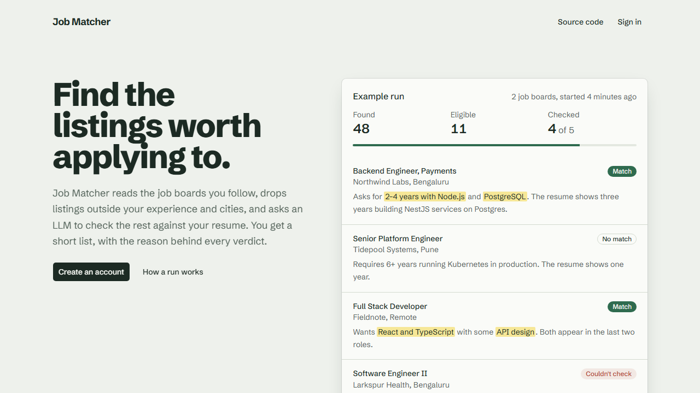
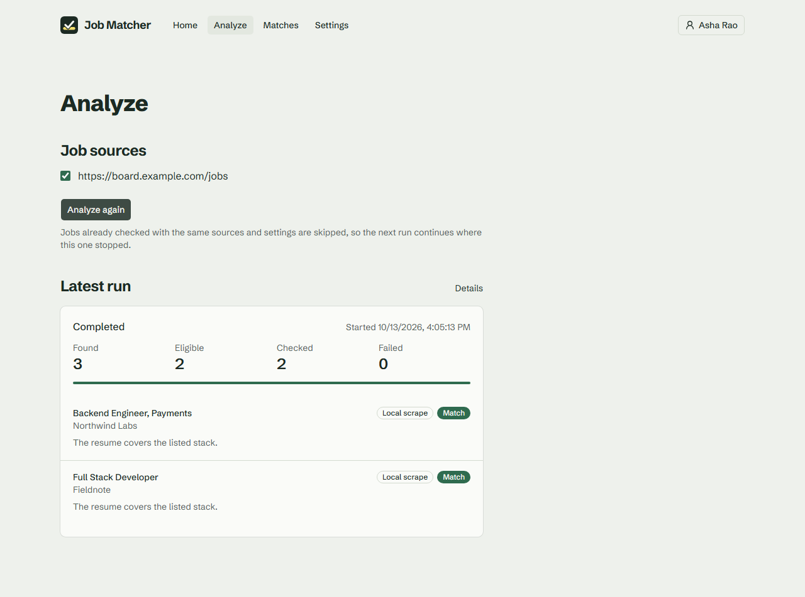
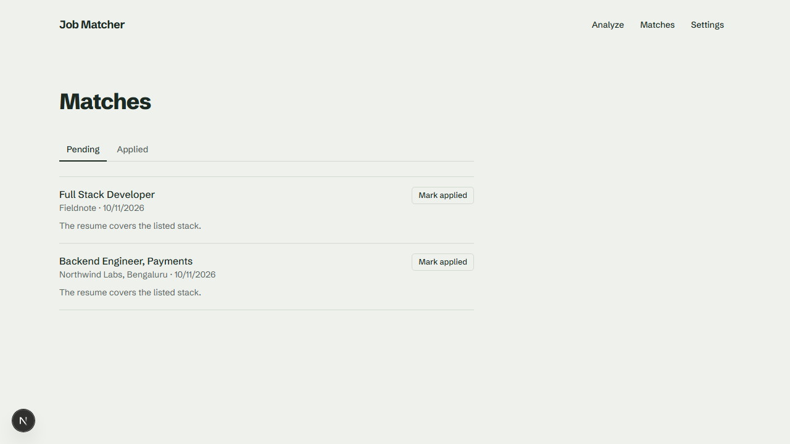
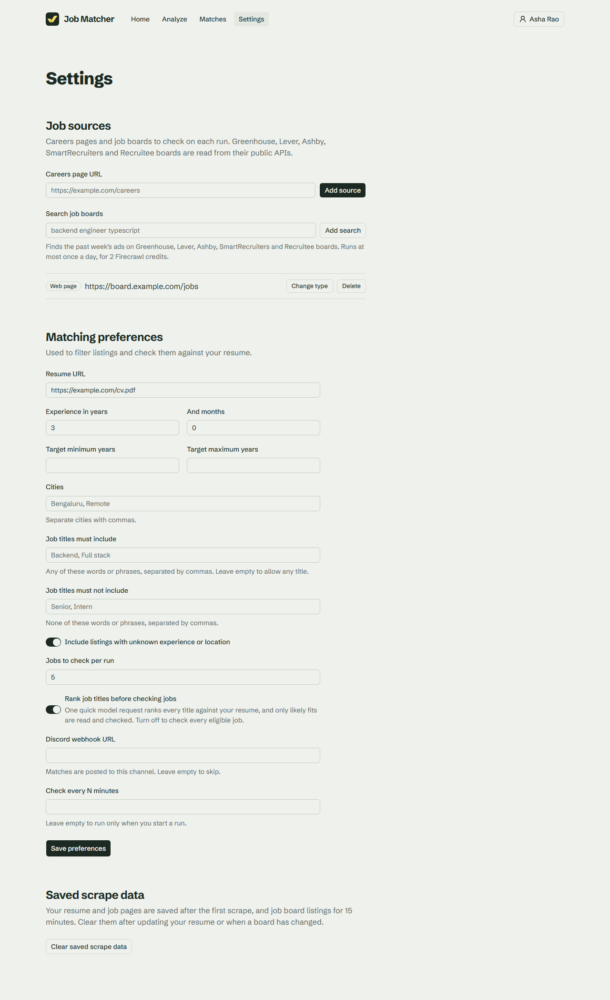
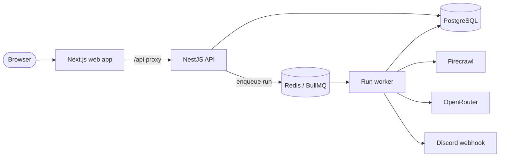

<p align="center"></p>

<h1 align="center">Job Matcher</h1>

<p align="center">
  <strong>Point it at the job boards you follow. It reads every new listing and tells you which ones fit your resume.</strong>
</p>

<p align="center">
  <a href="https://dl.circleci.com/status-badge/redirect/gh/Karthik-beta/AI-Job-Resume-Matcher/tree/master"></a>
  <a href="https://github.com/Karthik-beta/AI-Job-Resume-Matcher/releases/latest"></a>
  <a href="LICENSE"></a>
  
  
</p>

Job Matcher is a self-hosted AI job search tool. It scrapes the careers pages and job boards you follow, filters listings by location and experience, and checks each remaining job against your resume with an LLM.



## What it does

- **Watches your job sources.** Add Greenhouse, Lever, Ashby, SmartRecruiters or Recruitee boards, any careers page, or a web search for a role. It re-checks them on a schedule.
- **Filters out the noise.** It drops listings outside your locations, experience level and title keywords before spending anything on AI.
- **Reads each job against your resume.** An LLM scores the fit and explains it, so you open only the jobs worth applying to.
- **Keeps track for you.** Matches are saved, marked as applied when you apply, and can be posted to a Discord channel.

It is self-hosted: your resume and data stay on your machine.

## Quick start

All you need is [Docker Desktop](https://docs.docker.com/get-docker/) (Windows, macOS or Linux). Run one command:

**macOS / Linux / WSL**

```bash
curl -fsSL https://raw.githubusercontent.com/Karthik-beta/AI-Job-Resume-Matcher/master/install.sh | sh
```

**Windows (PowerShell)**

```powershell
irm https://raw.githubusercontent.com/Karthik-beta/AI-Job-Resume-Matcher/master/install.ps1 | iex
```

The installer:
1. Downloads the stack into `~/job-matcher`.
2. Generates the secrets.
3. Asks for two optional API keys.
4. Starts the app at **http://localhost:8080**.

Sign up, add a careers page and a link to your resume in **Settings**, then press **Analyze**.

| Mode | Keys | What you get |
| --- | --- | --- |
| **Demo** (press Enter at the key prompts) | none | The whole app on built-in sample pages. Free, and a good first look. |
| **Live** | [OpenRouter](https://openrouter.ai/keys) for AI matching, [Firecrawl](https://www.firecrawl.dev/app/api-keys) for scraping (free plan: 1,000 pages a month) | Real job boards and real matches. AI cost is a fraction of a cent per job. |

To switch from demo to live later, put both keys in `~/job-matcher/.env`, set `PROVIDERS=live`, and run `docker compose up -d` in that folder. To upgrade, run the installer again.

Prefer not to pipe a script into your shell? The [self-hosting guide](docs/self-hosting.md) has the three manual commands. It also covers HTTPS, backups and uninstalling.

| Analyze | Matches |
| --- | --- |
|  |  |

<details>
<summary>Settings</summary>



</details>

## Engineering highlights

- **Typed failure handling.** The matching pipeline is written with [Effect](https://effect.website). Every failure is a tagged error in the type signature ([`errors.ts`](apps/api/src/matching/errors.ts)), so the run decides on purpose what each one does:
  - a rejected API key stops the run
  - a blocked page fails only that job
  - a Discord outage is only logged
- **Safe, idempotent runs.** The API only queues a run; a BullMQ worker does the slow work.
  - The run id doubles as the queue job id, so a double click can't queue a run twice ([`schedule.ts`](apps/api/src/runs/schedule.ts)).
  - A per-user Postgres advisory lock stops two runs from overlapping ([`create-run.ts`](apps/api/src/runs/create-run.ts)).
- **Budget-aware scraping.** Each run reads the Firecrawl plan's remaining credits and keeps a reserve. Scheduled runs share an even daily allowance, so a frequent schedule can't use up the month early ([`credit-guard.ts`](apps/api/src/matching/credit-guard.ts)).
- **Hybrid scrape routing.** It scrapes on a self-hosted Firecrawl first and falls back to the cloud only for pages that block it. A site that blocks the local instance twice in a row goes straight to the cloud for a week ([`scrape-routes.ts`](apps/api/src/matching/scrape-routes.ts)). ATS boards are read through their public APIs at no cost.
- **Resumable work.** Scraped pages are cached in Postgres, and evaluations are keyed by a hash of the resume, sources, model and requirements ([`context-key.ts`](apps/api/src/matching/context-key.ts)). A rerun picks up where the last one stopped and never pays twice for the same job.
- **Cost controls on the LLM.** Before each run it checks that the model has an endpoint under a per-token price cap. It uses OpenAI's flex tier and backs off exponentially when flex capacity runs out ([`preflight.ts`](apps/api/src/matching/preflight.ts), [`completion.ts`](apps/api/src/matching/completion.ts)).
- **Tested like a product.**
  - 50+ test files, with a per-file coverage gate of 90% of lines.
  - Playwright end-to-end tests that run against fake providers in an isolated database.
  - CI that builds the production images, boots the full Compose stack, and runs the installer against it before anything merges.
- **Shippable.** It publishes multi-arch images (amd64 and arm64) to GHCR on every release, and installs with one command on Windows, macOS and Linux.

## Architecture



- **Web** (`apps/web`) is the only public service. It proxies `/api/*` to the API, so the browser talks to one origin and the session cookie stays first-party.
- **API** (`apps/api`) handles auth, sources, settings, runs and matches. Starting a run only creates a row and queues a job.
- **Worker** (`apps/api/src/worker.ts`) processes one run at a time:
  1. Check the OpenRouter key and model.
  2. Scrape the resume and each source's listings.
  3. Dedupe and filter the listings.
  4. Evaluate each job against the resume.
  5. Save matches and send the Discord alerts.
- It also runs each user's scheduled re-checks.
- **Providers:** Firecrawl scrapes pages, OpenRouter evaluates jobs with a strict JSON schema, and Discord receives match alerts. `PROVIDERS=fake` swaps all three for fixtures. That's how the demo mode and the end-to-end tests run with no keys.

### Design decisions

- **A queue, not the request.** A run scrapes several pages and makes one LLM call per job, which can take minutes on the free Firecrawl plan's 10 requests a minute. The API answers immediately with a queued run, and the page polls for progress.
- **Effect only where the failures are.** Scraping, rate limiting, retries, evaluation and notifications use Effect; Nest controllers and services stay plain async code. The two meet at one `ManagedRuntime`, built when the worker boots.
- **The cache lives in Postgres.** Scraped resumes, job pages and source listings are stored per user in a `PageCache` table. Listings are kept for 15 minutes (a day for search sources), and everything else until the user clears it. The cache survives restarts, needs no extra service, and can be cleared from Settings.
- **A single worker.** Concurrency is 1, so every run shares one Firecrawl rate limiter, and jobs are checked one at a time and never interleave. That's enough for a personal tool. More throughput would first need a shared, Redis-backed limiter.

## Tech stack

| Layer | Technology |
| --- | --- |
| Runtime and language | Bun, TypeScript |
| Frontend | Next.js 16, React 19, Tailwind CSS 4 |
| Backend | NestJS, Effect, better-auth |
| Data | PostgreSQL 17 with Prisma, Redis 8 with BullMQ |
| AI and scraping | OpenRouter (structured JSON output), Firecrawl (cloud or self-hosted) |
| Quality | Biome, Bun test, Playwright, CircleCI |
| Delivery | Docker multi-stage builds, Docker Compose, GHCR multi-arch images |

## Development

You need [Bun](https://bun.sh) and Docker.

```bash
cp .env.example .env    # then set BETTER_AUTH_SECRET, e.g. to the output of: openssl rand -base64 32
bun install
bun run db:migrate
bun run dev
```

`bun run dev` starts Postgres and Redis in Docker, then the web app at http://localhost:3000 and the API and worker with hot reload (health check: http://localhost:4000/api/health).

Set `PROVIDERS=fake` in `.env` to run the worker on fixtures with no API keys. With `PROVIDERS=live`, the worker needs `OPENROUTER_API_KEY` and a Firecrawl (see [configuration](docs/configuration.md)). The API refuses to start if a required variable is missing. When `.env.example` gains a new variable, copy it into your `.env`.

| Script | Description |
| --- | --- |
| `bun run dev` | Start Postgres and Redis, then the web app, API and run worker |
| `bun run db:migrate` | Create and apply Prisma migrations, then regenerate the Prisma client |
| `bun run lint` | Lint and format check with Biome |
| `bun run typecheck` | Type-check every app |
| `bun run test` | Unit and integration tests, with per-file coverage thresholds |
| `bun run test:e2e` | Playwright end-to-end tests on fake providers, in their own database |
| `bun run check` | All of the above (what CI runs) |

```
apps/api         NestJS API and the run worker
apps/web         Next.js frontend
packages/shared  Request schemas shared by both apps
prisma/          Database schema and migrations
e2e/             Playwright end-to-end tests
deploy/          Docker Compose stack for self-hosting
```

## Documentation

- [Self-hosting](docs/self-hosting.md): install, upgrade, live mode, HTTPS, backups, troubleshooting
- [Configuration](docs/configuration.md): scraping modes, job sources, filters, Firecrawl credits, OpenRouter routing
- [Contributing](CONTRIBUTING.md): git hooks, pull requests and releases

## License

[MIT](LICENSE) © Karthik P
